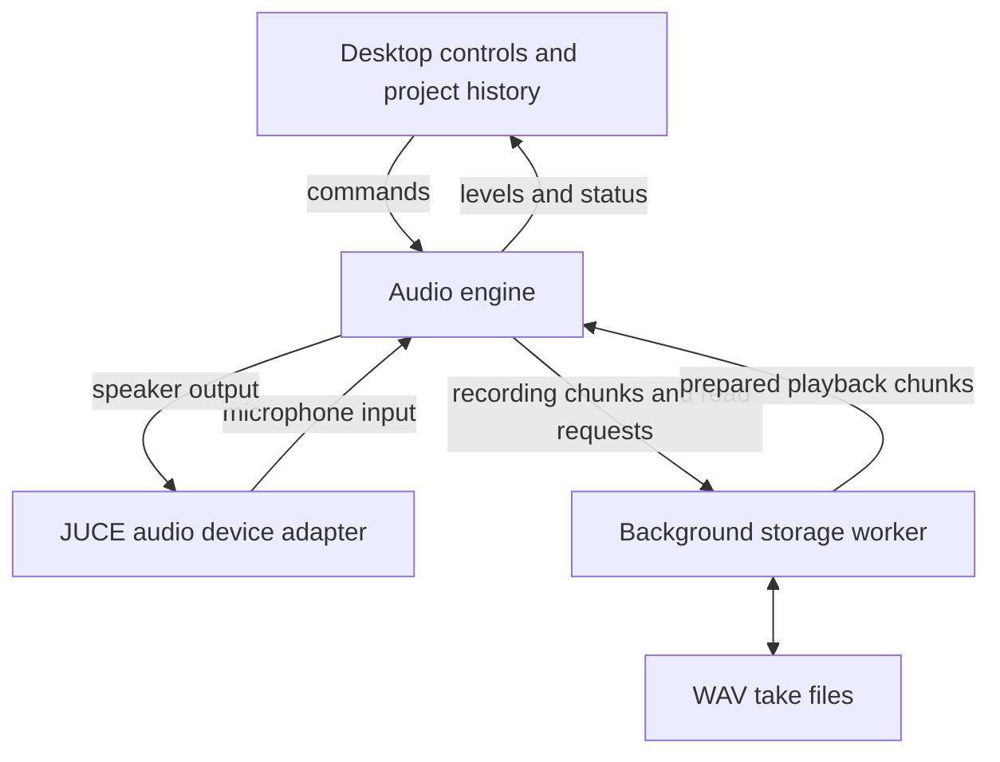

# Tape architecture

Tape has a desktop interface, an audio engine and a storage worker. The interface handles controls and project editing. The engine processes audio blocks. The worker reads and writes take files.

## Controls

The interface sends commands for recording, playback and level changes. The engine sends levels and transport status back. Project editing and revision history stay on the control side so they can run independently of audio processing.

## Audio engine

The audio device calls the engine for each block of sound. The engine uses prepared buffers and exchanges messages through fixed-size queues. It does not open files or wait for the storage worker inside the callback.

Each queue has one producer and one consumer. The producer finishes writing a message before publishing its position; the consumer checks that position before reading the message. This establishes when a slot is ready to use.

## Storage worker

The worker reads upcoming playback data and writes incoming recording chunks to WAV files. Queues provide temporary storage between the worker and engine. Their capacity is finite; behavior when storage falls behind is described in the [implementation notes](engineering-decisions.md).

## Timeline and project state

Recording positions use integer audio frames. The calibrated recording delay adjusts take placement on that timeline. Arrangement revisions refer to take files and layer positions, so changing the selected revision changes the session without rewriting audio.

JUCE-specific controls and device code are separate from the engine. Engine tests can run independently of the desktop interface.
