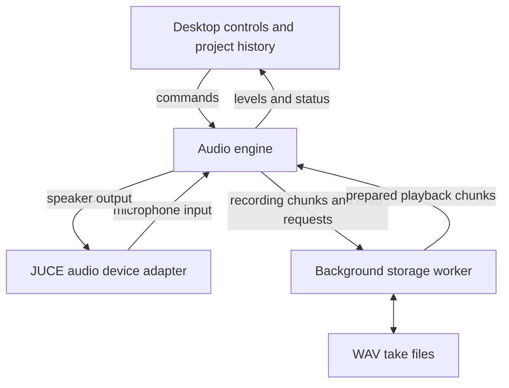

# Tape architecture

Tape separates three responsibilities: responding to the musician, producing the next block of sound, and moving recorded audio to or from disk. They share a timeline, but they do not all have the same timing requirements.

## The path through the system

The arrows between the engine and storage worker represent fixed-size queues, not direct file operations inside audio processing. A queue is a mailbox: one side publishes completed work and the other consumes it when ready.

## 1. Controls describe what should happen

The desktop UI posts commands such as recording, playback or a level change. The engine sends status back, allowing the UI to display levels and transport state without reading mutable audio state directly. Project editing and revision history belong on the control side.

## 2. The engine produces the next block

The audio device calls the engine repeatedly to supply sound. This callback uses prepared buffers and bounded messaging rather than opening files or waiting for storage. Each queue direction has one producer and one consumer, giving ownership a clear rule.

The producer writes a message before publishing its queue position. The consumer sees the published position before reading that message. This ordering prevents it from treating a partly written message as complete.

## 3. The worker handles files

The storage worker reads upcoming playback data and writes recording chunks. If it falls behind, the engine follows explicit gap and overflow policies instead of waiting indefinitely. A finite buffer gives the worker some breathing room; it cannot guarantee that every storage device will keep up.

Worst-case callback timing and storage throughput still need measurement on each target device.

## How timing and editing fit together

A recording's position is an integer count of audio frames. One frame is one sample instant across the channels. The measured playback-to-recording delay shifts take placement on that same timeline.

An arrangement revision refers to take files and their layers. Undo changes the selected arrangement; it does not undo a filesystem write. This is why take storage and editing history can be managed outside the time-sensitive audio callback.

The engine is separate from JUCE-specific controls and device code. That makes its behavior testable without opening the desktop app and leaves a clear adapter boundary for a future embedded implementation.
