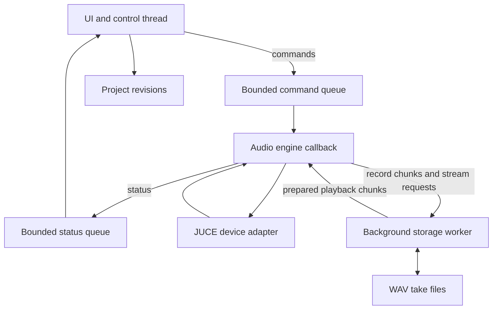

# Tape · Architecture

The core boundary is between work that must finish for the next audio block and work that can wait. JUCE connects the device to the portable C++ engine; storage and project editing live outside that callback.

Arrows to and from storage summarize queue-based communication, not direct filesystem calls from the audio callback. This is a responsibility map rather than a class diagram.

## Audio deadlines

The source uses fixed-capacity queues and preallocated buffers. Disk reads, writes and revision editing belong outside the callback. Acquiring a queue index makes the corresponding slot visible; releasing an index publishes completed work. Exactly one producer and one consumer own each queue direction.

Bounded capacity makes overload explicit. Recording gaps and playback underruns have test coverage in the private repository. This review does not certify every path reachable from the callback or measure worst-case execution time.

## Frame-based time

A take is placed on an integer-frame timeline. Calibration compares a known emitted signal with its recorded return to estimate delay. The source rejects an inconclusive measurement instead of accepting a guessed offset. Detailed algorithms and calibration orchestration remain private.

## Non-destructive editing

Recordings remain as take files; revisions describe which layers are arranged on each track. Undo and redo change the active revision. A new edit after undo replaces the redo branch in metadata without immediately deleting old audio files. This favors recoverability at the cost of storage growth and a future cleanup policy.
